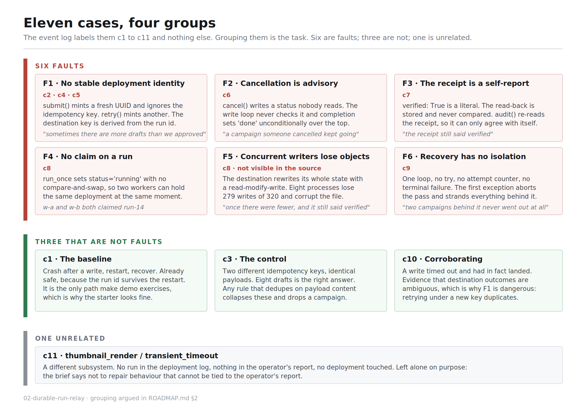
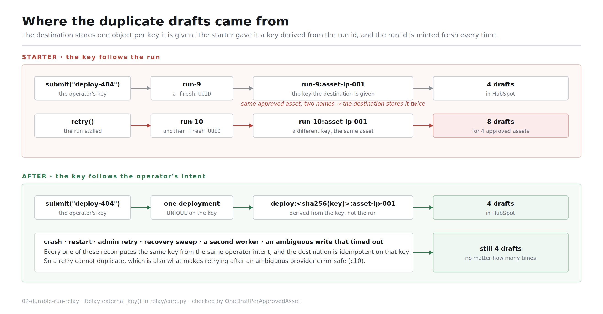
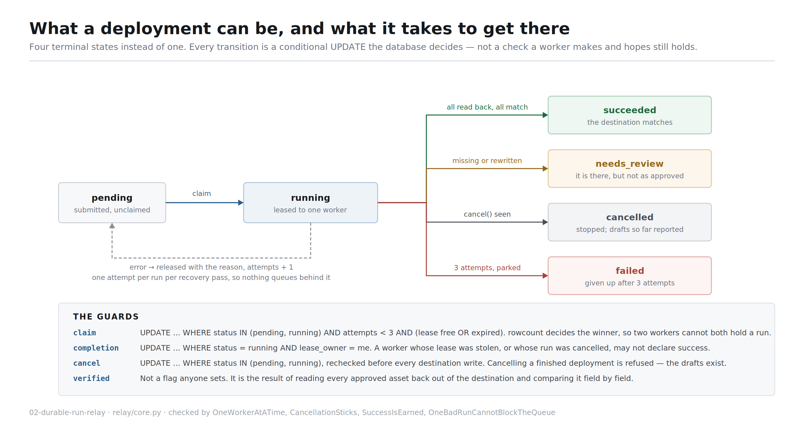
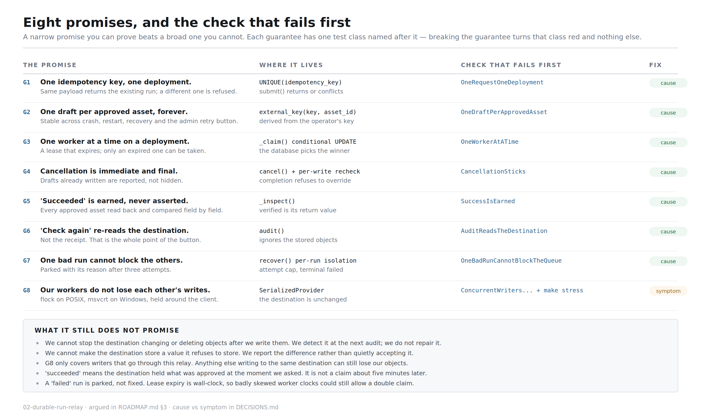
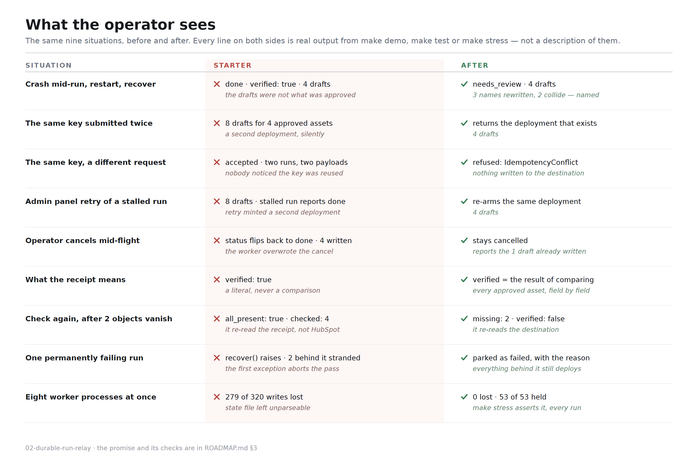

# How this was designed and how it was solved

This is the visual walkthrough. `ROADMAP.md` is the plan I committed before
touching any source. `DECISIONS.md` is the write-up. This file sits between
them and shows the reasoning in pictures.

---

## The problem, in one paragraph

An operator approves a landing page and three emails and asks for them to be
pushed into HubSpot as drafts. They do not trust what comes back. Sometimes
there are more drafts than they approved. Once there were fewer, and the
receipt still said verified. A campaign somebody cancelled kept going. A stuck
run took two campaigns down with it. The starter's crash-and-restart demo runs
clean anyway, which is the actual problem: **the demo exercises the one path
that already works.**

---

## How I worked

Evidence first, then a plan, then code. In that order, on purpose.

1. **Read and run the starter before editing anything.** Running is not
   editing. Half of what is wrong here does not show up in the source.
2. **Reproduce every case by hand** against the unmodified starter, so that the
   grouping is a finding and not a guess.
3. **Write `ROADMAP.md` and commit it alone**, with claims in it another
   engineer could reject.
4. **Then** write code, one guarantee at a time.
5. **Mutation-check the tests at the end** — break each guarantee, confirm the
   test named after it goes red. A test that passes on broken code is worthless.

---

## Step 1 — What the evidence actually said

Two findings mattered more than the rest.

**The demo prints its own worst bug and nobody reads it.** `make demo` says
`verified: true`, then dumps the receipt. Compare the receipt against the
fixture and three of the four approved display names come back different,
because the destination strips and truncates to 40 characters:

| approved                                                        | what the destination stored                |
| --------------------------------------------------------------- | ------------------------------------------ |
| `Summer 2026 ABM campaign - primary landing page`               | `Summer 2026 ABM campaign - primary landi` |
| `Summer 2026 ABM campaign email - product deep dive`            | `Summer 2026 ABM campaign email - product` |
| `Summer 2026 ABM campaign email - product deep dive, part two ` | `Summer 2026 ABM campaign email - product` |

The last two are not similar. They are **identical**. A marketer opening
HubSpot cannot tell which draft is the deep dive and which is part two. The
starter called that verified.

**The destination loses writes, and threads hide it.** `make stress` reports 48
objects most runs, 47 occasionally, and now and then dies with
`JSONDecodeError`. That reads like noise. It is not. The destination rewrites
its entire state with a read-modify-write and no locking. Under the GIL the
window is narrow. Across processes it is wide open:

```
writes issued : 320
objects held  : 41
LOST          : 279
  child w7 error: JSONDecodeError   (7 of 8 workers died this way)
```

This is the one finding I would not have got from reading the code, and it is
the operator's _"once there were fewer, and the receipt still said verified."_

---

## Step 2 — Grouping the eleven cases

The event log labels them `c1` to `c11` and gives nothing else. Deciding which
share a cause, which are noise, and which is unrelated is the task.



The two calls most worth arguing with:

- **c3 is not a bug.** Two different idempotency keys with byte-identical
  payloads must produce eight drafts. They are two separate operator intents.
  Any rule that deduplicates on payload content collapses them and silently
  drops a campaign. c3 sits right next to c2 in the log precisely to catch that
  mistake.
- **c11 is the unrelated one.** A `thumbnail_render` timeout in a different
  subsystem, with no run in the deployment log and nothing in the operator's
  report. The brief says not to repair behaviour you cannot tie to that report,
  so it is left alone and said so.

---

## Step 3 — Where the duplicate drafts came from

Three of the six faults are the same root cause seen from different angles: the
deployment had no stable identity.



The destination stores one object per key it is given. The starter handed it
`f"{run_id}:{asset_id}"`, and `run_id` is a fresh UUID minted on every `submit`
and every `retry`. So the same approved asset arrived under a new name each
time and the destination did what it was told: stored it again.

Deriving the key from the **operator's idempotency key** instead makes it
stable across crash, restart, recovery and retry. That single change closes c2,
c4 and c5, and it is also what makes retrying after an ambiguous provider error
safe — which is c10.

---

## Step 4 — What a deployment is allowed to be

One terminal state became four, and every transition became a guard the
database decides rather than a check a worker makes and hopes still holds.



The important part is not the extra states. It is that `succeeded` is now
expensive to reach. You get it only by reading every approved asset back out of
the destination and finding it matching. Anything else lands somewhere that
says what is wrong.

---

## Step 5 — The promise, and the check that fails first

A narrow promise you can prove beats a broad one you cannot.



Each guarantee has exactly one test class named after it. That mapping is not
decorative — I broke each guarantee in `core.py` in turn and confirmed only the
matching class goes red:

| mutation                                      | what went red                                                         |
| --------------------------------------------- | --------------------------------------------------------------------- |
| destination key derived from the run id again | 15 tests, led by `test_destination_key_does_not_depend_on_the_run_id` |
| `verified = True` as a literal                | the four verification and audit tests                                 |
| write loop stops checking cancellation        | `test_cancel_midflight_stops_further_writes_and_sticks`               |
| recovery stops isolating failures             | the four `OneBadRunCannotBlockTheQueue` tests                         |
| destination lock removed                      | `test_eight_worker_processes_lose_nothing`                            |

---

## Step 6 — The result, side by side



Every line on both sides is real output from `make demo`, `make test` or
`make stress`, not a description of them.

---

## Cause or symptom

Both can be the right call under time pressure. Shipping one while calling it
the other is not.

**Cause removed.** Identity is the operator's key, enforced by a `UNIQUE`
index, and the destination key is derived from it — duplicates cannot be
created rather than cleaned up afterwards. Claiming is a conditional UPDATE, so
the double claim cannot happen. Completion is conditional on still holding the
lease, so cancellation cannot be overwritten. `verified` is the output of a
comparison, so the receipt cannot claim more than it checked. Recovery isolates
per run and parks after three attempts, so one run cannot strand the queue.

**Symptom stopped, cause still there.** The lock around the destination. The
cause is a destination that is not safe for concurrent writers, and it is not
mine to change. Serialising our own callers removes _us_ as a cause of the
loss. The destination is exactly as capable of losing objects as it was before,
which is why `audit()` re-reads instead of trusting the receipt.

Reporting the truncated names is reporting, not repair. The drafts in HubSpot
are still not what the marketer approved. Somebody has to shorten the names.

---

## What broke while building it

Three of my own, all caught by running things rather than reading them.

1. **My first `recover()` recreated c9.** It broke out of the loop when a run
   made no progress, so the runs queued behind a failing one stayed `pending` —
   the exact bug I was fixing, in new clothes. A failing run now gets one
   attempt per pass and is stepped over for the rest of it.
2. **My first `stress.py` had pool workers passing `reclaim_after=0.0`.** That
   force-expires _live_ leases, so every worker stole every run mid-flight and
   eight healthy deployments were parked as `failed`. The harness told me,
   which is the argument for making `make stress` a check that exits non-zero
   rather than a report.
3. **My first destination lock was POSIX-only.** It caught the `ImportError`
   for `fcntl` and fell through to a `threading.Lock`, which is no lock at all
   across processes. Green on Linux, corrupted the destination on Windows. The
   lock now dispatches to `msvcrt.locking` on Windows, and where neither exists
   `LOCK_BACKEND` is `None` and the check for G8 skips **with that reason**
   rather than passing quietly. A guarantee that evaporates on a platform while
   the suite stays green is worse than one that is honestly absent.

---

## What this still cannot promise

- We cannot stop the destination changing or deleting objects after we write
  them. We detect it at the next audit. We do not repair it, and nothing
  re-audits on a schedule — an operator has to press the button.
- We cannot make the destination store a value it refuses to store. We report
  the difference; we do not silently rename the operator's asset to fit.
- G8 only covers writers that go through this relay.
- `succeeded` means the destination held what was approved **at the moment we
  asked**. It is not a claim about later.
- Lease expiry is wall-clock with no heartbeat table. Skewed clocks across
  worker machines could still allow a double claim.
- `list_objects()` scans the whole destination on every inspect. Fine at
  fixture scale, quadratic at real scale.

---

## Checking any of this yourself

```bash
make demo      # walks the operator's report, nine sections
make test      # 37 tests, one class per guarantee
make stress    # 8 worker processes, six checks, non-zero if one breaks
```

`make demo` does **not** print a clean run, and that is the point. The main
fixture ends `needs_review`. `fixtures/deployment_request_short.json` is there
to show `succeeded` is reachable and that the rule does not fire on everything.
